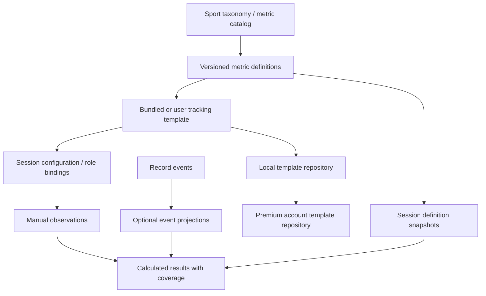

# Architecture and delivery proposal

All contracts and paths in this document are proposed unless described as
existing. This extends the current taxonomy and repository design; it does not
introduce a new state-management package.

## Separate definitions, templates, and observations



| Object | Responsibility / proposed additions |
| --- | --- |
| `MetricDefinition` (evolution of `TrackingDefinition`) | Identity, sport/catalog namespace, revision, family, name/aliases, definition, unit, eligible subject roles, capture semantics, event selectors, timing boundaries, context schema, deprecation/replacement metadata. |
| `TrackingTemplate` | Stable ID, schema and content revisions, sport/catalog compatibility, title/description/tags, ordered slots, suggested bindings, result specs, definition snapshots, origin. Immutable. |
| `TrackingTemplateSlot` | Stable slot ID, metric reference/revision, capture source, subject-role binding, context defaults/filter, optional shortcut, interaction preference. |
| `TrackingSessionConfiguration` | Session-specific role→subject mappings, visible slots, selected template revision, configuration overrides. Independent from preserved metric definitions. |
| `TrackingSession` | Add payload schema version, sport/catalog identity, metric snapshots, template origin, source-video identity and coverage records. Preserve observations and historical definitions when controls are hidden. |
| Observation / interval | Keep existing raw actions readable; add explicit observation/incident identity, context, provenance, and interval pairing for newer operations. |
| `MetricResult` | Value/unit plus sample size, denominator, unknown count, covered interval, source, and completeness/invalid status. Read-only output. |

Prefer a small discriminated definition model rather than making every kind a
nullable bag of fields. Keep capture primitive (`counter`, `interval`, later
`outcome`) distinct from source (`manual`, `recordEvents`, `calculated`) and from
display shape (`count`, `duration`, `ratio`, `rating`). Avoid making a percentage
look like an incrementable counter.

## Asset placement and versioning

Continue using `assets/sports/{sportId}.json` as the sport-owned starting point.
In the first implementation, add `trackingTemplates` referencing the existing
`trackingPresets`; no loader rewrite is required just to deliver templates.
Longer term use clear names such as `metrics` and `trackingTemplates`, with a
reader migration from `trackingPresets`. Split large catalogs into sibling
assets only when size or independent publication warrants it.

Use separate concepts for file schema version, catalog content revision, metric
revision, and template revision. The current taxonomy has `schemaVersion`, string
`revision`, and integer `contentVersion`; document their mapping instead of
overloading them further. Historical metric references should carry an explicit
catalog ID and revision, not assume a built-in sport is the only possible catalog.

Keep existing IDs byte-for-byte. New compound identity is
`catalogId + sportId + metricId + metricRevision`; imported `event_*` tracker IDs
are namespaced externally instead of renamed. Display-name changes do not alter
identity. A substantive definition change produces a new revision or metric ID
and an explicit compatibility decision.

Proposed validation rules:

- Unique metric, template and slot IDs within their namespace; nonempty labels.
- Every metric and referenced category/event belongs to the same sport/catalog.
- New templates cannot reference archived definitions or incompatible revisions.
- Required snapshot matches the referenced definition; custom dependencies travel
  with exports or are declared unresolved, never replaced silently.
- Timer mode applies only to intervals; units and aggregation match the kind.
- Context values and subject roles are valid for the metric and competition.
- All calculation dependencies exist; no cycles; unit-safe allowlisted operators.
- Exclusive timer groups have explicit unknown/none behavior and overlap rules.
- Unsupported schema/kind stays readable as an unavailable item when possible;
  reject editing instead of defaulting it to a counter.

## Example template contract

Illustrative JSON, **not accepted by today's parser**. This is the full future
contract; phase 1 needs only manual slots, snapshots, and basic configuration.
`metricRevision: 1` below is a proposed revision assigned to the current precise
definitions by migration, not an existing field in the hockey asset.

```json
{
  "schemaVersion": 1,
  "id": "hockey.passing.basic",
  "revision": 1,
  "sportId": "hockey",
  "catalogId": "built-in:hockey",
  "catalogRevision": "hockey-2",
  "name": "Passing",
  "description": "Record one outcome for every observed pass by a selected player.",
  "subjectRoles": [{"id": "focus", "kind": "player"}],
  "slots": [
    {"id": "completed", "metricId": "hockey_pass_completed", "metricRevision": 1, "source": "manual", "subjectRole": "focus"},
    {"id": "intercepted", "metricId": "event_pass_intercepted", "metricRevision": 1, "source": "manual", "subjectRole": "focus"},
    {"id": "incomplete", "metricId": "event_pass_incomplete", "metricRevision": 1, "source": "manual", "subjectRole": "focus"},
    {"id": "unknown", "metricId": "event_pass_unknown", "metricRevision": 1, "source": "manual", "subjectRole": "focus"}
  ],
  "coverageRequirement": "allPassAttemptsForBoundSubjectAndWindow",
  "results": [
    {"id": "recordedAttempts", "operator": "sum", "slots": ["completed", "intercepted", "incomplete", "unknown"]},
    {"id": "knownAttempts", "operator": "sum", "slots": ["completed", "intercepted", "incomplete"]},
    {"id": "knownCompletion", "operator": "ratio", "numeratorSlot": "completed", "denominatorResult": "knownAttempts", "unknownSlot": "unknown", "zeroDenominator": "unavailable"}
  ]
}
```

Export adds the resolved metric snapshots and provenance. An account-owned
template uses an account-scoped ID and source-template reference; it does not
claim the bundled template's identity after customization. Applying the template
binds `focus` to a session subject; that identity is not written back to the
reusable template.

## Capture and calculation behavior

For the first release, each manual outcome click remains an ordinary count
recorded with the existing engine. The UI explains one outcome per opportunity;
it cannot yet prove outcomes are mutually exclusive. Later introduce atomic
outcome observations so correcting Saved to Goal changes the same incident and
undo restores it as a unit.

For event-derived metrics, a selector must specify sport, category/type,
subject/role, context, and coverage. Existing Record `actor` values are free-form
strings, while trackers use subject IDs; explicit roster resolution is needed
before deriving individual-player totals. Do not match jersey text silently.

Do not implement a bidirectional background copier between `TrackingEvent` and
`GameEvent`. Prefer a read-only projection of Record events, or a deliberately
linked capture command producing one canonical observation with distinct views.
Track source/incident IDs so a shot, goalie save and defender block cannot create
multiple attempts. Manual and Record series can be compared, but never summed
without an explicit reconciliation operation.

Allow only simple versioned calculation operators initially: count, sum, duration,
ratio, and rate. Validate dependency graph and units; do not evaluate arbitrary
Dart/JavaScript or user-supplied executable expressions from template files.
Recompute only affected results with scoped notifiers/indexes. Moving the video
playhead should not rebuild the entire catalog or refold the full event history.

## Timer protocol

Video timestamps remain the clock. At 0.5× or 2× playback, a 10-second video
interval is still 10 seconds. Pausing leaves the interval open without adding
wall-clock time. A whistle is a separate live-play boundary, not a media pause.

Recommended seek behavior: finalize active intervals at the last pre-seek
position, mark the skipped range unobserved, and require an explicit new start
after seeking. Backward review must not silently overlap existing measured time;
offer review/edit or deliberate additional coding, and validate duplicate spans.
Use the same interval validity rules for live totals, saved sessions and exports.

Before a source-video replacement or closing a session, finalize or mark active
intervals incomplete at the old position. Restoring a file with an unmatched
start should offer recovery from that observation, not start running at an
unrelated current playhead. Timer stop/cancel and undo must preserve interval
identity; normal replay of raw data should agree with displayed totals.

Define exclusivity by entity and measurement dimension. Starting our team
possession stops opponent possession at the same timestamp; starting a player's
puck-control timer does not stop their shift timer. Zone occupancy requires
offensive, neutral, defensive, and unknown states. Different players may hold
independent simultaneous intervals.

## Template repositories and premium storage

Add a typed `TrackingTemplateRepository` with list/load/saveRevision/archive and
import/export support. Implement local storage first, following the quick-event
repository's queued-write approach. Template storage contains small configuration
documents, not session streams. Cache and library operations belong outside the
capture controller. Inject repositories through `AppComposition` and use a
dedicated `ChangeNotifier` for library state.

For cloud, align with the existing
[premium architecture](../premium-cloud-architecture/README.md):

```text
users/{uid}/trackingTemplates/{templateId}                    # library metadata
users/{uid}/trackingTemplates/{templateId}/revisions/{revision} # immutable body
```

Metadata includes title, sport, current revision, owner, origin, server timestamps,
and archive status. A revision includes schema version, slots, compatible catalog
references, required snapshots, and result definitions. Sessions store the applied
configuration/snapshots, so opening historical data does not require a network
fetch of a possibly deleted template.

Add a proposed capability such as `canSyncTrackingTemplates`, separate from
`canEditCustomTaxonomy` and `canSaveCloudSessions`. Server-side rules enforce
owner identity, entitlement for writes, immutable revision bodies, field/size
limits, and trusted owner metadata. Current rules end in default deny; adding
a repository alone will not enable cloud templates. Validate with emulator tests
before rollout, consistent with the existing cloud plan.

Use optimistic revision concurrency: a save states its base revision. A stale
save creates a recoverable conflict with both versions retained; do not apply
last-writer-wins to ordered slots or metric definitions. Write revision body and
metadata pointer atomically. Retry with an idempotency key so a reconnect does
not create duplicate templates or revisions. Unsynced changes remain visibly
local drafts; errors provide retry/export without losing work.

Read the small metadata list with pagination; load revision bodies when selected.
Avoid a network write for each counter click or every UI rearrangement. Separate
account namespaces in local caches, pause queued writes on sign-out/expiry, and
check the account again when flushing. Choose bounded library/revision sizes
before pricing or quotas; exact limits are a product decision, not assumed here.

Private templates require no video storage and should contain no player/video
data by default. Team libraries later need their own owner model, roles and
permission checks; do not widen private paths to arbitrary team IDs in phase 1.

## Migration and compatibility

1. Read existing unversioned tracking files as legacy payloads. Preserve raw
   events, definitions, hotkeys and unknown extension fields where possible.
2. Derive a candidate sport from consistent definition sport IDs; use a matching
   cloud envelope when available. For mixed, empty or conflicting identities,
   keep the import readable and require explicit resolution before adding
   sport-specific definitions or resaving under a claimed sport. A missing field
   is not sufficient evidence to rewrite every imported item as hockey.
3. Snapshot legacy definitions verbatim. If label/definition/kind differs from
   today's catalog, preserve a legacy revision rather than substituting the
   current one. No automatic remapping of vague On Net, Touch, or Turnover meaning.
4. Give a loaded session a custom/ad-hoc configuration reflecting its current
   selection. Do not silently attach the closest named template.
5. Keep referenced definitions and subjects when hidden. Repair aggregate state
   from raw events and expose unresolved references without deleting observations.
6. Add versioned template import/export with its own document discriminator.
   Reject a tracking-session JSON file passed to template import, and vice versa.
7. Make session application transactional and reversible. Tests cover older
   files, old IDs, unknown future kinds, and custom snapshots after catalog edits.
8. Preserve existing raw-action CSV for compatibility; add a documented new
   export version for result/interval data with source, unit, coverage, signed
   delta, and correctly escaped labels. Timer exports must agree with UI totals.

Existing event QuickEventPreset data remains supported. A later common library
shell can present both event and tracking templates, but their typed payloads and
application semantics remain distinct. Do not migrate event presets into tracker
counters simply because they have matching names.

## Delivery phases and acceptance

| Phase | Deliverable | Acceptance evidence |
| --- | --- | --- |
| 0: identity and preservation | Versioned session identity; safe visibility; timer boundary policy | Deselect/reselect and template change preserve counts/labels; sport/video switching cannot mix observations; display, replay and export intervals agree. |
| 1: useful local templates | Bundled first six sets; local library; roles, previews, save/duplicate/apply/import/export | Empty and populated sessions work; apply is idempotent/undoable; no data copying; hotkey conflicts handled; anonymous offline flow stays usable. |
| 2: better capture and metrics | Atomic outcomes, typed context/coverage, basic ratios, exclusive timers; optional Record projections | One attempt produces one outcome; correction updates dependencies; zero/unknown/selective coverage states tested; no duplicate event/manual totals. |
| 3: private premium library | Account capability, repository, revisions, conflict resolution and rules | Two-device/offline conflict tests; account-switch isolation; expired subscription policy; unauthorized writes denied; historical sessions open with deleted templates. |
| 4: expanded sports and packs | Soccer/basketball/volleyball assets; coaching validation; optional team libraries later | At least two structurally different sport fixtures validate; sport switch restores correct templates; rule variants do not require widget conditionals. |

Each implementation phase runs formatting, `flutter analyze`, and focused unit /
widget tests. UI changes also need a running-app check at narrow/wide dock edges,
phone/tablet sizes, text scaling, keyboard operation and touch timer cancellation.
Preserve paint boundaries, laser/drawing throttling, and scoped cell updates.

Useful non-hockey fixtures include volleyball reception scores and basketball
2/3-point shot outcomes: these expose assumptions that every outcome is binary,
every count contributes one point, or every sport has hockey periods/strength.
Fixtures do not require prematurely enabling those sports in the product.
