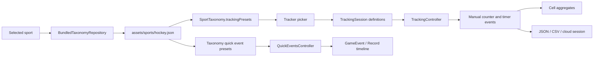

# Current-state audit

Audited against the working tree on 2026-10-05. Findings below distinguish
implemented behavior from proposed behavior and code-review risks from reproduced
failures. File references are repository-relative.

## Runtime data flow

There is no runtime arrow from the Record timeline to tracking aggregates.

| Responsibility | Evidence | Assessment |
| --- | --- | --- |
| Historical defaults | `lib/models/tracking_presets.dart`, `HockeyTrackingPresets` | 30 old definitions. Production UI does not import it; `test/hockey_revision_test.dart` checks preservation of old IDs and kinds. |
| Active defaults | `assets/sports/hockey.json`, `trackingPresets` | 75 asset definitions; already sport-owned, but exposed as a flat list of counters and timers. |
| Load and validate | `lib/services/taxonomy_repository.dart`, `loadSportTaxonomy`; `lib/models/sport_taxonomy.dart`, `validate` | Loads `assets/sports/$sportId.json`, caches, validates references. Strong basis to extend. |
| Select metrics | `lib/widgets/player_tracking_panel.dart`, `_showTrackerPicker`, `_TrackerPickerDialog` | Uses current taxonomy, searches label/definition, groups by Counters/Timers. No named tracking sets. |
| Capture | `lib/controllers/tracking_controller.dart` | Generic counters and video-position timers; per-cell notifiers and aggregates already support efficient updates. |
| Subject model | `lib/models/tracking_models.dart`, `TrackingSubject` | Label, jersey number, team ID, color. No typed player/team/goalie/line distinction. UI says players. |
| Session model | `TrackingSession` in the same file | Embeds definitions, subjects, raw events, hotkeys. No session sport, schema version, template origin, coverage, or metric revision contract. |
| Local interchange | `lib/services/tracking_storage_service.dart` | JSON session save/load and raw action CSV. This is file interchange, not an autosaving template repository. |
| Premium sessions | `lib/services/tracking_session_repository.dart`; `lib/models/cloud_sessions.dart` | Firestore repository stores a tracking payload inside a versioned, sport-labelled cloud envelope. No template collection. |
| Product composition | `lib/app/app_composition.dart`, `app_capabilities.dart`; `firestore.rules` | Existing local/Firebase composition and entitlement checks can host template repositories. New collection needs explicit rules. |
| Existing template precedent | `lib/models/quick_event.dart`; `lib/controllers/quick_events_controller.dart`; `lib/services/quick_events_repository.dart` | Sport-filtered user presets, bundled suggestions, apply/save/rename/duplicate/delete, queued local writes. Reuse concepts, not the entire payload or replacement semantics. |

## Inventory and overlap

The [CSV inventory](current-inventory.csv) lists every active tracker. Counts:

- 30 retained historical IDs, plus 45 newer `event_*` definitions.
- 55 event-linked counters, exactly covering the 55 active event types.
- 11 counters with no `eventTypeId`; these include broad totals such as shot
  attempts, pass attempts, possession losses, and controlled transitions.
- 9 timers: puck time, shift time, moving, stationary, offensive zone,
  defensive zone, pressure, slot defense, and battle time.
- 17 definitions use generic "Manual count of..." or "Manual duration of..."
  text rather than an operational counting or timing rule.

The event-linked definitions share wording with the event taxonomy, verified by
the hockey revision test. That consistency is useful, but does not ensure that
every event is a useful numeric metric. Counts of "Gap control", "Positioning",
or "Support" currently count coaching observations, not success or quality.

Several independent buttons describe overlapping sets:

| Existing selection | Risk | Recommended interpretation |
| --- | --- | --- |
| Shot Attempt, Shots on target, Goal, Saved, Missed, Blocked | A goal may generate three manual increments and is easy to count inconsistently. | Record one outcome per attempt; derive attempted/on-target totals when coverage supports them. |
| Pass Attempted, Completed, Intercepted, Incomplete, Unknown | Independent attempt and outcome clicks can drift. | One resolved outcome per attempt; support incomplete footage explicitly. |
| Possession losses (all causes), Lost control, Intercepted pass, Battle lost | Summation can count one loss more than once; battle loss need not lose prior possession. | Use a defined possession-change incident and causal attribution. |
| Zone Entry, Controlled Zone Entry, Carry-in, Pass-in, Dump-in | Crossing, method, and control are different facts. | Capture method plus retained/lost/contested/unknown outcome. |
| Check / pressure applied, Pressure, Stick check, Body check | A combined legacy count overlaps several precise actions. | Preserve the old meaning; prefer separate, defined actions in new templates. |
| Shot Saved and Goalie Save | Two viewpoints on one attempt. | Link the incident; use one metric source for shot denominators. |

## Findings to address before templates become foundational

Priority here means implementation order for this feature, not a production
incident classification. Unless stated otherwise these are source-review findings.

| Priority | Finding and evidence | Consequence and recommended action |
| --- | --- | --- |
| P0 | `TrackingSession` has no sport ID. `_saveCloudTrackingSession` in `lib/main.dart` uses the current selected sport (or hockey). `_loadCloudTrackingSession` loads the tracking payload but does not restore the sport/taxonomy. | A loaded session can be saved under the wrong sport once other sports are enabled. Make session identity authoritative, validate envelope/payload agreement, and restore the session's catalog snapshot. |
| P0 | `_onSportSelected` changes taxonomy without reconciling the tracking session; `_replaceVideoSource` does not reset/rebind tracking data or explicitly finalize its timers. | Old observations and timers can cross sport/video boundaries. Define explicit new-session versus resume/reattach-video operations; finalize at the old video position before switching. |
| P0 | `removeTracker` removes the definition and aggregate cell, but leaves raw events and hotkeys. `addTracker` only appends the definition; it does not rebuild prior aggregates. The picker calls these methods when applying selection changes. | Deselecting/reselecting can hide labels and show zero while older raw events remain; a later reload can restore different totals. Separate visibility from stored definitions. Template changes must never use definition deletion to hide a metric. |
| P1 | `removeSubject` similarly removes identity and aggregate cells while preserving events. | Historical attribution becomes an ID fallback. Archive/hide referenced subjects; preserve snapshots. |
| P1 | Tracker IDs are not globally sport-namespaced (`event_*`), new definitions default to hockey, and validation does not check tracker sport against taxonomy sport. | Shared template libraries require compound identity and explicit sport; keep old IDs intact and use sport/catalog namespace externally. |
| P1 | `TrackingDefinition.fromJson` falls back to counter for unknown kinds and toggle for unknown timer modes. | A future calculated metric could silently become an editable counter in an older client. Add version checks and unsupported-item handling rather than reinterpretation. |
| P1 | `SportTaxonomy.validate` checks tracker ID uniqueness and category/event references, but not archived event links, sport agreement, revision agreement, timer compatibility, units, or formulas. | Extend validation as part of the new schema. Current asset passes its existing validation. |
| P1 | Timers use video positions, but seeking forward counts skipped footage and backward stop clamps the display to zero. `getTimerIntervals` and CSV can still emit a reversed interval. | Centralize seek policy and interval validation. Video position is necessary but does not automatically make seeking safe. |
| P1 | `loadSession` clears active timers; unmatched starts do not resume. Removing a running tracker/subject clears runtime state without recording cancel/stop. | Define recoverable unfinished intervals; finalize or mark incomplete consistently across save/load, hide, undo, and video changes. |
| P1 | `TrackingEvent.metadata` is flexible, but normal controller capture has no metadata parameter and there is no typed coverage/incident/outcome contract. | Context-based metrics and reliable rates require an explicit capture path and validated attribution, not just JSON fields. |
| P1 | No source declaration or bridge to `GameEvent`; no formula/dependency engine. | `eventTypeId` cannot be treated as automatic counting. Start with declared manual mode; introduce event projections separately. |
| P2 | Subjects share every session tracker; `addSubjectWithSameTrackers` adds only the subject. Hotkeys address `subjectId:trackerId`. | A reusable template needs role bindings and visible slots, not copied live subject IDs or an assumed per-player tracker list. |
| P2 | `TrackingSession` lists/maps are mutable and publicly exposed; controller makes defensive copies only when loading. | New template models should use immutable collections and `copyWith`, with atomic apply operations through notifiers. |
| P2 | CSV `value` exports a positive magnitude for decrement; action provides the sign. Labels are quoted without escaping embedded quotes. | Document legacy action CSV; add a correctly escaped export with signed delta, unit, interval identity, and source. A naive sum of current `value` is wrong. |

The existing UI already warns that manual counts and Record events are separate.
That warning helps, but model-level source selection will be more reliable.

## What to keep

- `ChangeNotifier` and scoped cell listeners; avoid a global rebuild on every
  video position update or template selection.
- Video-position timestamps and raw observations that permit audit and undo.
- Embedded historical definitions in session files.
- Taxonomy repository caching and validation.
- Asset-based event definitions and local quick-event save/duplicate patterns.
- Existing dock layout, keyboard conflict handling, and platform file helpers.
- The current 30 historical tracker IDs and imported custom tracker definitions.

## Verification scope

Existing tests cover tracker hotkey conflicts, counter indexing, basic timer
stop/undo, panel layout at different widths, taxonomy loading/caching, the hockey
revision's tracker compatibility, and quick event presets. They do not establish
safe template application, cross-sport session switching, exclusive duration
groups, formula completeness, or template synchronization.

The investigation did not reproduce every source-review finding in a running
player. Add targeted regressions when implementing those changes; avoid treating
the existing tests as evidence that the proposed behavior already works.

## Validation record

Completed against the working tree on 2026-10-05:

- `flutter test test/tracking_controller_test.dart test/taxonomy_test.dart
  test/hockey_revision_test.dart test/player_tracking_panel_test.dart
  test/quick_events_test.dart`: **46 tests passed**.
- `flutter analyze`: **no issues found**.
- `dart format --output=none lib test`: **145 files checked, 0 changes**. The
  restricted invocation stalled; the approved external rerun completed.
- All **75 inventory rows** matched the asset's IDs and current definition text;
  every row has a review recommendation.
- All **17 relative Markdown file links** in the package resolved.

This is documentation-only work. Existing application/test edits were preserved.
No new behavior, running-player interaction, cloud deployment, or new metric
formula was validated by these baseline checks.
