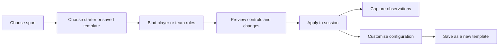

# Quick tracking templates

A template is a named, reusable answer to "What am I reviewing in this pass
through the video?" It selects a few capture controls, their subjects and context,
and optional results. It is separate from both a sport's full metric catalog and
a game's observations.

## Candidate hockey starters

The first six sets below can start with existing counter/timer definitions and
observed totals. Calculated results are a later layer; do not promise them merely
by shipping the template selector. IDs of current definitions are in the
[inventory](current-inventory.csv).

| Template | Coaching question / default subject | Capture controls | Results after calculation support | Dependencies |
| --- | --- | --- | --- | --- |
| Faceoffs | Do we establish control after the draw? / our team | Won, Lost, Unknown (3) | Recorded draws; decided win share with unknown count | Existing definitions. Center attribution optional, not assumed. |
| Passing | How reliably does this player move the puck? / selected player | Completed, Intercepted, Incomplete, Unknown (4) | Attempts; known-outcome completion and coverage | Existing definitions. One outcome per attempt; do not also ask for Attempted. |
| Shot outcomes | What happened to our attempts? / our team or selected shooter | Goal, Saved, Missed, Blocked, Unknown (5) | Attempts, on target, shooting percentage | Existing definitions. No extra Goal → On target → Attempted clicking. |
| Puck battles | How do contests resolve? / our team with participant | Won, Lost, Unchanged, Unknown (4) | Contest count; win share among wins/losses | Existing definitions. Team outcome and player assessment remain separate. |
| Player involvement | What is this player's involvement during observed shifts? / selected player | Pass received, Recovery, Lost control, Shift timer (4) | Observed counts and shift duration; later interval summaries | Existing definitions, with published reception/shift rules. Lost control excludes separately classified passes/battles. |
| Goalie outcomes | What on-target shots did this goalie face? / selected goalie | Save, Goal against, Puck play (3) | Known shots faced and save percentage; puck plays shown separately | Existing counters. State goalie identity and coverage; unknown shot outcome capture is a follow-up requirement for incomplete footage. |
| Zone exits | How do we leave our zone? / our team | Carry-out, Pass-out, Clear-out, Denied (4) | Attempts, crossing success, retained-control share | Method counters exist. Control outcome and unknown crossing need new structured capture before rates. |
| Zone entries | How do we enter and retain the puck? / our team | Carry-in, Pass-in, Dump-in, Denied (4) | Crossing success; retained control; dump recovery | Same context/coverage dependencies as exits. |
| Defensive actions | What discrete actions does this player contribute? / selected player | Takeaway, Interception, Shot block, Pressure (4) | Separate action totals, later linked consequences | Existing counters; define pressure episodes. No composite defensive score. |
| Possession and territory | Who controls play, and where? / teams | Our control, Opponent control, Contested, Unknown (4 state controls) | Control-time share and unobserved duration | New exclusive interval group and live-play boundary support. Zone group is an optional separate page, not four more simultaneous controls. |
| Goalie rebounds | What follows an eligible save? / selected goalie | Frozen, Safe rebound, Dangerous rebound, Unknown (4) | Eligible saves by disposition; rubric-based control share | New outcome capture linked to saves; not four unrelated counters. |
| Special-teams review | How effective are defined advantage episodes? / our team | Advantage episode start/stop, Goal for, Goal against, Shot outcome group | Time and shot totals; later PP/PK opportunity rates | Rule-aware episode model; full outcome group expands only when needed. |

For the initial Goalie outcomes template, offer observed Save/Goal against totals
without an unqualified save percentage when any eligible shot is unobserved or
unclear. Adding an unknown-shot outcome is a better follow-up than silently
classifying it as a save or dropping it from a supposedly complete game.

The setup should recommend one team or one player per review pass. Multi-subject
tracking remains available, but the app should not imply that one observer can
reliably capture every player and every metric during continuous playback.

## What a template stores

| Store | Example |
| --- | --- |
| Stable identity and version | `hockey.passing.basic`, revision 1, schema version 1 |
| Sport/catalog compatibility | hockey, built-in hockey catalog, pinned metric revisions |
| Name, description, tags | Passing; player development; beginner |
| Ordered capture slots | Completed, Intercepted, Incomplete, Unknown |
| Subject roles | selected player; our team; selected goalie |
| Optional context defaults | period unset; pressure unset; analysis team bound when applied |
| Interaction preferences | toggle/hold where supported, suggested shortcut, grouping |
| Optional result definitions | observed attempts; known-outcome completion |
| Definition snapshots | enough to open/import the template without the original custom catalog |
| Origin | bundled, local, account-owned; optional source-template ID and revision |

Do not save actual subjects, jersey lists, observed counts, timer start positions,
session IDs, video paths/URLs, or assertions that a future game's coverage is
complete. Coverage requirements belong in a template; observed coverage belongs
in each session. A roster preset, if added later, is a separate concept.

## Applying and editing

For an empty session, make a starter easy to choose with its coaching question,
three to five preview controls, and subject role visible. Bind a role from the
current selection when possible. Keep definitions accessible by tap/keyboard,
not only a hover tooltip. Show actual result availability, including missing
dependencies, in the template preview.

For a populated session, the default is **add controls**. An optional **replace
visible controls** operation changes the workspace view only. It retains all
definitions referenced by observations, counts, timing intervals, subjects, and
hotkeys needed for history. Reapplying the same template should be idempotent.
Only identical metric revision + source + subject binding + context is eligible
for reuse; two distinct filters on the same metric may intentionally be separate
slots. Do not use label equality for deduplication.

A hidden running timer must not continue unnoticed. Stop it at the current
position with an explicit recorded operation, or keep an always-visible running
timer control. Offer undo of the whole application transaction, including timing
effects, rather than a chain of unrelated add/remove operations.

Copying a bundled template creates a user-owned configuration. Editing a user's
template creates a new revision. Sessions already using revision 1 continue to
mean revision 1 unless the user explicitly changes their configuration. Deleting
a template removes it from the library but does not remove recorded observations.

Suggested hotkeys are preferences, not authoritative bindings. Resolve against
reserved playback/staged-entry keys and existing session bindings before apply.
Preserve valid existing shortcuts; leave a conflicted new shortcut unassigned
with an inline explanation. Add active-subject routing deliberately: current
bindings are concrete subject/tracker pairs, not portable role bindings.

## Catalog browsing and responsive behavior

Use the current sport as the catalog boundary. Within it, show families such as
Passing, Shots, Possession, Transitions, Goaltending, and Exposure. Reuse event
category names where appropriate. Counter/Timer/Calculated are useful filters
and badges, but should not be the main navigation hierarchy.

Search labels, aliases, and definitions. Keep deprecated or unavailable metrics
accessible when opening historical data, while excluding them from default new
templates. Templates requiring unsupported capture types should say which
capability is missing rather than producing empty controls.

Retain the existing Flutter theme and docking system. Narrow docks and phones
should stack controls; wider docks can show compact rows. Use 48 logical-pixel
Material targets, keyboard-accessible ordering alternatives, text scaling, clear
timer state, visible focus, and semantic labels. Color supplements the outcome
label. A numeric total update should not move focus away from the current player.

These are workflow recommendations based on the ui-ux-pro-max Quick Reference
and the existing app. Two focused CLI searches returned an unrelated typography
result; no verified dataset match was found for progressive disclosure. That
result was discarded rather than treated as evidence for this design.

## Local and premium boundary

Recommended product direction, subject to pricing decisions:

| Capability | Local/free | Premium account | Later team feature |
| --- | --- | --- | --- |
| Use bundled sport templates | Yes | Yes | Yes |
| Choose/reorder existing built-in metrics | Yes | Yes | Yes |
| Save local template configurations | Yes | Yes, also cached | Yes |
| Import/export a template file | Yes, subject to supported metric types | Yes | Yes |
| Save/sync private templates across devices | No | Yes | Yes |
| Revision history and account recovery | Local versions as implemented | Cloud versions | Cloud versions |
| Author new metric meanings/custom taxonomies | Preserve existing boundary; not introduced as a free feature by this proposal | Follow `canEditCustomTaxonomy` | Follow organization permissions later |
| Share editable team libraries | No | Not in first private-library release | Separate roles and ownership |
| Marketplace / public coach packs | Not in first release | Not in first release | Separate product decision |

Saving a selection of existing metrics is different from authoring a new metric
or taxonomy. This preserves the premium architecture's existing custom-taxonomy
boundary while making local quick configuration useful.

An import can display a self-contained historical snapshot without automatically
granting catalog-editing rights. Define template import rights separately from
custom-metric authoring; never silently drop custom items on import.

On expiry or sign-out, keep local work usable. Prefer continued owner read/export
access to saved templates, with cloud writes and new sync gated by entitlement.
This is a proposed template policy: current session rules require premium even
for reads, so it needs an explicit product decision and its own security rules.
Account caches must be isolated and detached on account changes. Offline edits
remain drafts until the active account's entitlement and revision are validated.

The premium value is a reliable personal library, available across devices and
recoverable over time. It does not require video uploads, a marketplace, or team
permissions to be useful.
